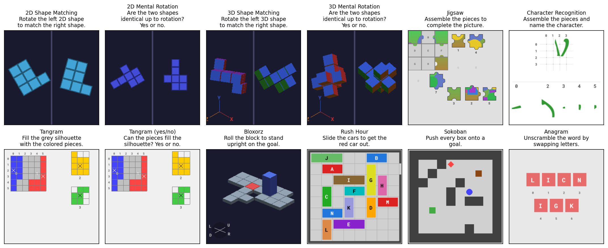

# Do multimodal models imagine electric sheep?

This repository contains the code to train and evaluate the models in the paper:

**Santhosh Kumar Ramakrishnan\*, Carl Vondrick\*, Raja Giryes\*, Philipp Krähenbühl, Vladlen Koltun**<br>
Apple · \*Equal contribution

[Paper](https://arxiv.org/abs/2605.09693) · [Project page](https://apple-aiml-research.github.io/ml-mental-imagery/)

We find that large multimodal models develop mental imagery when solving spatial puzzles, and
they do imagine sheep when solving sheep puzzles. We fine-tune a Qwen3.5 VLM to solve twelve diverse
visual reasoning tasks – including tangram, jigsaw, sokoban, 3D mental rotation, and rush hour – that
require understanding geometry, spatial relationships, and the consequences of actions. By
supervising the model to predict the open-loop sequence of actions to solve a puzzle from an initial
state, we show that the model's activations after each action encode meaningful visual information
about the intermediate state. This finding suggests that an imperfect visual world model begins to
form as a byproduct of learning to select correct actions, in the absence of any explicit visual
supervision. Building on this observation, we study two techniques to sharpen and use the mental
images formed by the model. We find that integrating as few as sixteen visual tokens per step into
the chain of thought improves the average solve rate from 83% to 89%, with particularly strong gains
on reasoning-heavy tasks such as jigsaw and 3D mental rotation.

<p align="center">
  
</p>

## Installation

Requirements:

- Linux x86-64 with NVIDIA GPUs (the paper used one node with 8× NVIDIA B200).
- The [Rust toolchain](https://rustup.rs) and [uv](https://docs.astral.sh/uv/).
- Ubuntu with NVIDIA's CUDA apt repository, and root or sudo: setup installs the CUDA 12.9 compiler
  and headers ([`scripts/install_cuda.sh`](scripts/install_cuda.sh), into `/usr/local/cuda-12.9`).

```bash
git clone https://github.com/apple-aiml-research/ml-mental-imagery.git
cd ml-mental-imagery
bash scripts/setup.sh
```

[`scripts/setup.sh`](scripts/setup.sh) installs the CUDA 12.9 compiler and, if it is missing, Rust,
downloads the fonts and recreates the Anagram word list the engine embeds
([`scripts/download_words.py`](scripts/download_words.py)), builds the Python environment, the Rust
engine and the CUDA kernels, then runs the Python tests. Compiling FlashAttention from source often
takes tens of minutes; setup prints each compiler invocation so you can follow its progress. Base
models and the LlamaGen tokenizer are downloaded from the Hugging Face Hub on first use.

## Preparing prerequisites

Only Visual Supervision and Visual CoT need these; Action Supervision, State CoT and Boxes CoT can
be trained right away.

**FSQ visual tokenizer.** The target codec of the visual prediction head, needed by every
`*/visual_supervision` run. Trains on one GPU:

```bash
uv run python -m mental_imagery.prepare.train_fsq fsq=board_256
```

**Visual-token embedding init.** Visual CoT runs initialize the visual-token embeddings from the
model's own vision encoder, one table per model. Uses all visible GPUs:

```bash
uv run python -m mental_imagery.prepare.embed_init model=qwen3_5_9b visual_tokens=llamagen
```

Other models are selected the same way with `model=`: `qwen3_5_0_8b`, `qwen3_5_2b`, `qwen3_5_27b`,
`qwen3_5_35b_a3b`, `gemma4_e2b` and `internvl3_5_1b`.

## Training

| Method | Config name |
|---|---|
| **Action Supervision** | `action_supervision` |
| **Visual Supervision** | `visual_supervision` |
| **State CoT** | `state_cot` |
| **Boxes CoT** | `boxes_cot` |
| **Visual CoT** 64×64 / 128×128 | `visual_cot_64`, `visual_cot_128` |

Pick a run with `experiment=<model>/<method>`:

```bash
uv run torchrun --nproc-per-node 8 -m mental_imagery.train experiment=qwen3_5_9b/visual_cot_64
```

The command uses 8 GPUs. On smaller GPUs, lower `training.per_gpu_batch_size` and raise
`training.gradient_accumulation_steps` by the same factor. Checkpoints and `metrics.jsonl` are
written to `outputs/<model>/<method>/`.

The main runs of the paper (Qwen3.5-9B):

| Experiment | Method | Needs |
|---|---|---|
| `qwen3_5_9b/action_supervision` | Action Supervision | none |
| `qwen3_5_9b/visual_supervision` | Visual Supervision | `fsq_board_256.pt` |
| `qwen3_5_9b/state_cot` | State CoT | none |
| `qwen3_5_9b/boxes_cot` | Boxes CoT | none |
| `qwen3_5_9b/visual_cot_64` | Visual CoT 64×64 | `embed_init/qwen3_5_9b_llamagen.pt` |
| `qwen3_5_9b/visual_cot_128` | Visual CoT 128×128 | `embed_init/qwen3_5_9b_llamagen.pt` |

A visual probe can be attached to `action_supervision` to visualize internal hidden states using the
`visual_probe` config.

The experiments of the other models are in
[`mental_imagery/configs/experiment/`](mental_imagery/configs/experiment).

## Evaluation

```bash
uv run python -m mental_imagery.eval checkpoint=outputs/qwen3_5_9b/action_supervision/checkpoints/step_025000
```

This starts a vLLM server on all visible GPUs and writes per-task solve rates to
`<checkpoint>/eval/benchmark/results.json`. To evaluate every saved checkpoint of a run, pass the
run directory:

```bash
uv run python scripts/evaluate_run.py outputs/qwen3_5_9b/action_supervision
```

**Base model (zero-shot).** The untrained model has never seen the `<action>`
format, so it is prompted with the task, the action grammar and a per-game
output instruction. The actions in its answer (after the reasoning span) are
replayed and scored exactly like a trained model's. Works for every model:

```bash
uv run python -m mental_imagery.eval_base model=qwen3_5_9b   # -> outputs/qwen3_5_9b/base/eval/benchmark/
```

**Token replacement.** This test decodes a Visual CoT checkpoint on one GPU, replaces every
generated board as set by `mode`, and writes to `<checkpoint>/eval/token_replacement/<mode>/`:

```bash
for mode in none ground_truth black_frame uniform random_history initial_frame; do
  uv run python -m mental_imagery.ablation.token_replacement \
    checkpoint=outputs/qwen3_5_9b/visual_cot_128/checkpoints/step_025000 mode=$mode
done
```

## Visualization

Evaluation saves each episode's raw generation by default. After evaluating a Visual CoT or Visual
Supervision checkpoint, optionally render its saved episodes to see the boards it imagines. Each
figure shows, after every action, the true board above the imagined one; the figures and an
`index.html` are written to `<checkpoint>/eval/visualize/`:

```bash
uv run python -m mental_imagery.visualize checkpoint=outputs/qwen3_5_9b/visual_cot_64/checkpoints/step_025000
```

## Citation

```bibtex
@inproceedings{Ramakrishnan2026,
  author = {Santhosh Kumar Ramakrishnan and Carl Vondrick and Raja Giryes and Philipp Kr{\"a}henb{\"u}hl and Vladlen Koltun},
  title = {Do Multimodal Models Imagine Electric Sheep?},
  booktitle = {NeurIPS},
  year = {2026}
}
```

## Acknowledgements

This work builds on:

- The [LlamaGen](https://github.com/FoundationVision/LlamaGen) VQ-16 image
  tokenizer (MIT License); its model code, itself modified from taming-transformers and
  MaskGIT, is adapted in `mental_imagery/visual_tokenizers/llamagen.py`.
- [vLLM](https://github.com/vllm-project/vllm) for inference.
- Open-licensed fonts (SIL OFL 1.1, Apache 2.0, DejaVu) for board labels and
  Character Recognition glyphs; see [`assets/fonts/README.md`](assets/fonts/README.md).
- The 1913 *Webster's Unabridged Dictionary* (public domain), via
  [Project Gutenberg](https://www.gutenberg.org/ebooks/29765) and
  [OPTED](https://www.mso.anu.edu.au/~ralph/OPTED/), for the Anagram word list, which setup
  recreates from OPTED; see [`engine/games/anagram/SOURCE.md`](engine/games/anagram/SOURCE.md).

## License

This code is released under the [Apple Sample Code License](LICENSE). Third-party code and its
licenses are listed in [ACKNOWLEDGEMENTS](ACKNOWLEDGEMENTS).
